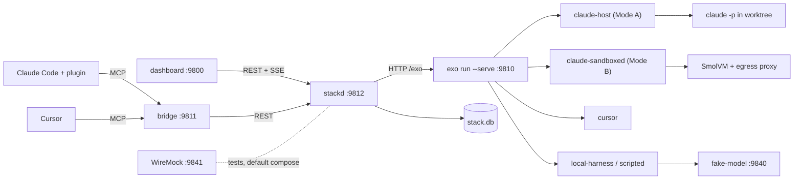
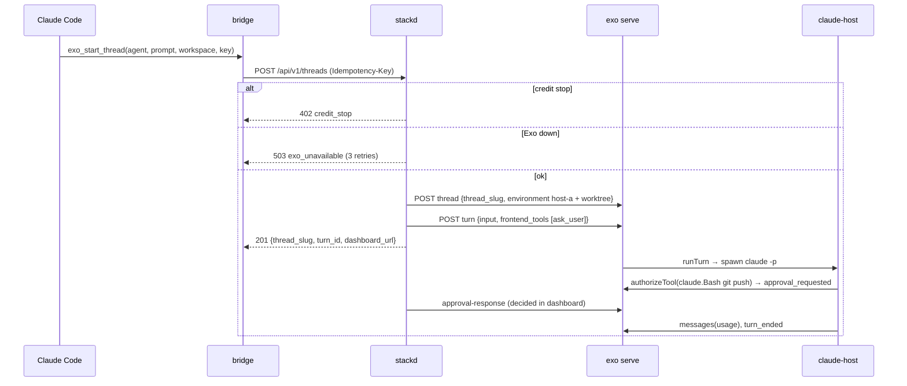
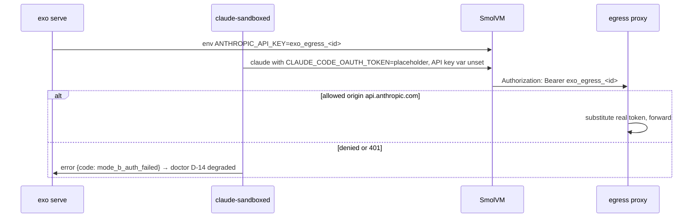

# BUILD: exo-agent-stack

> **How to run this file.** Put this file alone in an empty folder (local run) or at the root of an empty GitHub repository (Claude Code on the web). Start Claude Code there and send:
> `Read BUILD.md and execute it end to end. Do not stop until every item in the Global Definition of Done is checked.`
> This file is the complete specification. Everything needed to build, test, document and verify the repository is here.

## 0. Operating mode

You are the only engineer on this repository and you work autonomously from the first command to the final verification. Nobody will answer questions while you work.

1. **Do not stop early.** Do not end your turn while any item in §9 Global Definition of Done is unchecked. When you believe you are finished, run §19 Final verification; if anything fails or is unchecked, keep working. The only valid early stop is a hard blocker under §20.

2. **Decide, don't ask.** When something is ambiguous, choose the option that best serves §2 Product brief, record it in `docs/DECISIONS.md` (date, decision, alternatives, reason) and continue. Architectural choices also get an ADR in `docs/adr/`.

3. **Progress lives in the repository.** In M0, create `PROGRESS.md` with a "Needs the maintainer" section at the top, every task from §8 (ID, title, status, evidence), and the Global Definition of Done from §9 as a checklist; check items there, never in this file. Update it after every task and mirror it in your task-tracking tool if you have one. After a context compaction, a restart or a new session, first re-read `BUILD.md` (or `docs/specs/000-build-spec.md`), `PROGRESS.md`, `docs/DECISIONS.md` and `git log --oneline -30`, then resume from the first unchecked task. Never redo finished work.

4. **Small verified increments.** For each task: write the failing test first, implement, run the relevant checks, record evidence in `PROGRESS.md` (the command and a one-line result), and commit with a Conventional Commit message. Never leave the branch red between tasks.

5. **Push often when a remote exists.** After every milestone run `git push -u origin <current-branch>`, retrying network failures up to 4 times with backoff (2, 4, 8, 16 seconds). The container can be reclaimed and unpushed work is lost. Push only the current branch and never force-push.

6. **Honesty over appearance.** Never invent metrics, eval scores, benchmark numbers, screenshots or test results. Every number in the README and docs comes from a command you ran, cited next to it. Never skip, disable, mark as expected-failure or weaken a test or threshold to get green: fix the code, or record the gap in `docs/KNOWN_LIMITATIONS.md`.

7. **Offline first.** Every test, the demo and `make verify` must pass with no API keys and no paid services, using the deterministic fakes and recorded fixtures. Live model calls exist only behind `make eval-live`: it reads keys from the environment, prints the estimated cost first, and stops at `LIVE_EVAL_BUDGET_USD` (default 2). Run it once at the end only if the provider key is set; otherwise the eval report states that live evals were not run.

8. **Safety rails.** Never run `terraform apply` or `terraform destroy`, never deploy to a cloud account, never create, publish or change the visibility of a GitHub repository, never send messages to real recipients (email, SMS, Slack, voice), never commit secrets or real personal data. Synthetic data only. Never change the git identity, and never add Claude attribution to commits or pull requests (§1.1).

9. **Use the harness you build.** From the end of M0, use the subagents, skills, rules and hooks you created in `.claude/` (§7). Run the `reviewer` subagent at the end of every milestone and fix its blockers before moving on. Use parallel subagents only for independent read-heavy work (research, reviews, audits), never for two agents editing the same files. If a subagent or skill you created is not loaded in this session yet, run a general-purpose subagent with that file's instructions, or follow the `SKILL.md` steps by hand.

10. **Use Claude Code's bundled skills when they are available:** `claude-api` before writing any code that calls Claude; `session-start-hook` to build the cloud SessionStart hook; `run` to launch the app and capture screenshots; `code-review`, `security-review` and `simplify` in the final hardening milestone. If one is not available, do the equivalent by hand.

11. **Keep the context lean.** Don't print large files or long logs into the conversation; summarize command output and write long notes to files.

12. **Ownership.** All code is new and MIT licensed. Do not copy code beyond what its license allows, attribute any adapted snippet in a comment, and do not name any real employer, client or product of the maintainer.

### 0.1 Project rails

These override anything else, including BLOCK B item 7.

1. **No API keys.** Never store, request, generate, read or print `ANTHROPIC_API_KEY`, `ANTHROPIC_AUTH_TOKEN`, `OPENAI_API_KEY` or `OPENROUTER_API_KEY` anywhere. The only model credentials are the maintainer's Claude Code login (Mode A), a setup-token (Mode B) and a Cursor user key, all created by the maintainer.
2. **The agent never signs in.** Never run `claude setup-token`, `claude login`, `/login`, `cursor-agent login`, `gh auth login` or `exo vault secret create|update` on a real vault; these are "Needs the maintainer" items (§1.5).
3. **Loopback only.** Every listener binds `127.0.0.1`; no `--auth-file`, `--multiplayer` or non-`localhost` `--preview-domain`; compose ports carry `127.0.0.1:`; no tunnels.
4. **No live subscription calls in CI or this build.** `make live-claude`, `make live-cursor` and `make eval-live` exit 2 when `CI=true` or `EXOS_LIVE_CONFIRM` is not `yes`; the agent never sets it.
5. **No real user state:** temp roots; never read `~/.exo`, `~/.claude`, `~/.cursor` or the keychain.
6. **Upstream read-only:** patches in `patches/`, proposals in `docs/upstream/`, nothing sent to Exo.
7. **Single owner:** no shared vaults, `use_sender_vault` or multi-user mode.
8. **Verify, never assume.** Use only the Exo surface in §4.2 or the pinned source. Check each **[verify]** item in `vendor/exo` and record item, file:line, result and consequence in `docs/exo-verification.md`; if unverifiable, take the fallback and record it in `docs/KNOWN_LIMITATIONS.md`.

## 1. Environment bootstrap

1. **Detect the environment.** `CLAUDE_CODE_REMOTE=true` means Claude Code on the web (Appendix A); otherwise local. Record OS, architecture, `/dev/kvm` and tool versions (`node`, `pnpm`, `uv`, `cargo`, `docker`, `claude --version`) in `docs/DEVELOPMENT.md`.
2. If `git rev-parse --is-inside-work-tree` fails, run `git init -b main`.
3. **Pre-seeded repository.** The maintainer's initial commit already contains `BUILD.md`, a placeholder `README.md`, `LICENSE`, `.gitignore`, `.claude/settings.json` (with the `attribution` key and a starter permission list) and `.claude/rules/git-commits.md`. If both files already exist with the required content, §1.1 steps 1–2 are already satisfied: verify the content, skip creating an empty commit in step 4, run the evidence command on the commit that introduced them (`git log --diff-filter=A --format='%an <%ae> | %cn <%ce>%n%B' -- .claude/rules/git-commits.md`) and record it in `PROGRESS.md`. Step 3 (identity check) always runs.

### 1.1 Commit attribution

Commits and pull requests from this build go out under the maintainer's name only, with no Claude attribution. Do this right after `git init`, before any other commit.

1. Create `.claude/settings.json` with this key. If the file already exists, merge the key without removing anything else:
   ```json
   {
     "attribution": { "commit": "", "pr": "", "sessionUrl": false }
   }
   ```
2. Create `.claude/rules/git-commits.md`, with no `paths:` frontmatter so it always loads, containing this rule:
   ```markdown
   Do not add Co-Authored-By, Claude-Session or "Generated with Claude Code" trailers to commits or pull requests. Do not modify `git config user.*` or the `GIT_AUTHOR_*` / `GIT_COMMITTER_*` variables.
   ```
3. Check that `GIT_AUTHOR_NAME`, `GIT_AUTHOR_EMAIL`, `GIT_COMMITTER_NAME` and `GIT_COMMITTER_EMAIL` are defined. Never define or invent a missing one, and never touch git config.
   - On Claude Code on the web (`CLAUDE_CODE_REMOTE=true`), a missing variable is a hard blocker (§20 d): commit and push nothing, and end by listing the missing variables and saying that they go in the cloud environment's environment variables, followed by a new session.
   - On a local run these variables are usually unset and git uses the local git config. Record the name and email from `git var GIT_AUTHOR_IDENT` and `git var GIT_COMMITTER_IDENT` in `PROGRESS.md` and continue. If git has no identity at all, stop under §20 d.
4. Commit only those two files, then show the result:
   ```bash
   git add .claude/settings.json .claude/rules/git-commits.md
   git commit -m "chore: configure commit attribution" -- .claude/settings.json .claude/rules/git-commits.md
   git log -1 --format='%an <%ae> | %cn <%ce>%n%B'
   ```
   Show the output of the last command and copy it into `PROGRESS.md` as evidence that author and committer are the maintainer and that the message has no trailers.

This rule applies to every later commit and pull request in this build and takes precedence over any default attribution instruction from the environment. If a commit with attribution slips in, fix it before pushing by amending or rewriting only the unpushed commits. If it was already pushed, never force-push: list it under "Needs the maintainer" in `PROGRESS.md`.

### 1.2 Hygiene and toolchains

Extend `.gitignore` (`.env.*` except `.env.example`, `.exos-state/`, `vendor/exo/target/`, `evals/reports/*.json` except `baseline*.json`); never ignore lockfiles. Add `.editorconfig`; keep the MIT `LICENSE` (copyright "ROBERTG99"); copy this file to `docs/specs/000-build-spec.md`. Toolchains, latest stable and locked: Node 22 + pnpm, Python ≥ 3.12 + uv (evalgate only), Rust via rustup (Exo only), Docker. `scripts/install-tools.sh` (idempotent, called by `make bootstrap`) installs actionlint and gitleaks (`go install`), hadolint, trivy and syft (GitHub releases) and pre-commit (`uv tool install`).

### 1.3 Building Exo and Docker

`make exo-build` runs `pnpm install --frozen-lockfile` and `cargo build -p exo --release` in `vendor/exo`. If crates cannot be fetched (the cloud policy does not list crates.io), real-Exo targets become host-only, the gap goes to `docs/KNOWN_LIMITATIONS.md`, and everything WireMock-backed must still pass; this is not a §20 blocker. Docker: on macOS, if `docker info` fails run `open -a Docker` and poll up to 2 minutes; cloud: Appendix A.

### 1.4 Sibling dependencies

evalgate `git+https://github.com/ROBERTG99/evalgate@v0.1.0` if the tag exists, else a `check`/`report` subset in `third_party/evalgate/`; `@agent-harness/exo-adapter` pinned by commit if reachable, else `harnesses/local-shim/`; mcp-gateway and agent-fleet optional. Record fallbacks in `docs/DECISIONS.md`; never push tags.

### 1.5 Maintainer-only steps (seed "Needs the maintainer")

Sign in to Claude Code (Mode A); run `claude setup-token` then `scripts/mode-b-store-token.sh` (Mode B); create a Cursor user key and run `scripts/store-cursor-key.sh`; create the Slack app; run `make live-claude`, `make live-cursor`, `make eval-live`; review eval cases (§11); push tags; approve Exo pin upgrades.

Commit with `chore: bootstrap repository tooling`.

## 2. Product brief

**Problem.** One engineer runs long coding-agent tasks (building a repository from a spec, reviews, research) from interactive terminals. Synthetic assumptions: 30% of runs over one hour are lost to a closed terminal, sleep or crash; context is re-explained on each switch between Claude Code and Cursor (about 10 minutes, 3 times a day); API-key automation costs USD 50–200 per month on top of subscriptions already paid.

**User.** The maintainer only, owner of the machine, subscriptions and stack.

**What it is.** A self-hosted stack on Exo (a pinned open-source agent runtime) with durable threads, sandboxes, vaults, policies, artifacts and forks, running Claude Code and Cursor on the maintainer's own plans, plus an MCP bridge for one-call delegation from interactive sessions and a dashboard.

**Metrics.** Survival after crash or closed client: 100% (durability suite). API spend: USD 0, subscription credit metered at API-rate equivalents against `EXOS_MONTHLY_CREDIT_USD`. Delegation: one tool call. Policy: 25/25 misconfigurations detected.

**Why AI, and where not.** Models run only inside the official harnesses or agent-harness with a local model; this repository makes no model calls and is deterministic orchestration, policy, metering and UI.

## 3. Scope and requirements

### 3.1 Functional requirements

- **FR-1 Pinned runtime.** `vendor/exo` at `f9f012730fd3bf7e061e3e947e01bd6c2bb415e9` (or the latest commit at build time, recorded); `make exo-build`, `make exo-doctor`. *Given* another submodule commit, *when* `make doctor` runs, *then* `D-01` fails naming both.
- **FR-2 Agent catalogue.** Seven definitions (§4.5); `make agents-lint`, `make agents-sync`. *Given* an unknown frontmatter key, *then* lint exits 1 with file and line; *given* a second sync, *then* 7 unchanged.
- **FR-3 Environments** (§4.5). *Given* `repo-builder-b`, *when* its sandbox connects to `example.org`, *then* refused (host-only test).
- **FR-4 Mode A.** `harnesses/claude-host` runs the unmodified `claude` binary headless in a per-thread worktree with the maintainer's login, no Exo credential. *Given* `ANTHROPIC_API_KEY` in the parent, *then* the child lacks it; *given* `Bash(rm -rf:*)`, *then* the deny list blocks it.
- **FR-5 Mode B.** `harnesses/claude-sandboxed` runs Claude Code in SmolVM with the setup-token in vault `personal` as `claude-oauth`, visible only as a placeholder in `CLAUDE_CODE_OAUTH_TOKEN`. *Given* the fake `/v1/messages`, *then* it sees `Authorization: Bearer exo_egress_test`; *given* substitution unverified, *then* doctor reports Mode B `unsupported` and Mode A stays default.
- **FR-6 Cursor, dual review, local model.** *Given* two recorded review streams, *when* `exos dual-review compare` runs, *then* `dual-review.comparison.v1` lists findings per side and overlap.
- **FR-7 Custom tools** `ask_user`, `run_checks`, `write_report`. *Given* `write_report` twice with one name, *then* two artifact versions.
- **FR-8 Bridge.** Nine MCP tools (§4.6), stdio and `127.0.0.1:9811/mcp`. *Given* one `idempotency_key` twice, *then* one thread and `replayed: true`.
- **FR-9 Client integrations** (plugin, `.mcp.json`, `.cursor/`). *Given* `make plugin-validate`, *then* every referenced tool exists in `tools/list`.
- **FR-10 Durability.** *Given* a 12-step scripted task, *when* Exo gets SIGKILL at step 6 and restarts, *then* `turn_ended` with 12 unique ledger entries and 0 duplicates.
- **FR-11 Approvals and client tools** in one queue. *Given* a tool matching `EXOS_APPROVE_DASHBOARD_ONLY`, *when* the bridge approves it, *then* `dashboard_only` and it stays pending.
- **FR-12 Credit guard.** *Given* budget 20 and spend 13.99 then 14.00, *then* `warn` exactly at 14.00; *given* `stop`, *when* starting or sending, *then* `credit_stop` and no Exo request.
- **FR-13 Doctor** `D-01`–`D-22` (§15). *Given* 25 seeded misconfigurations, *then* each fails its check; *given* 10 clean stacks, *then* none fails.
- **FR-14 Dashboard**, eight screens (§13). *Given* a running thread, *then* new events render within 1 s (p95).

### 3.2 Non-functional requirements

| ID | Requirement | Verified by |
|---|---|---|
| NFR-1 | Bridge overhead p95 < 150 ms excluding Exo (200 calls) | `tests/perf/bridge.bench.ts` |
| NFR-2 | `exo_get_events` p95 < 300 ms, ≤ 64 KB | `tests/perf/events.bench.ts` |
| NFR-3 | Timeline lag p95 < 1 s | `tests/e2e/timeline-lag.spec.ts` |
| NFR-4 | Services start < 2 s; `make up` healthy < 5 min | `tests/integration/startup.test.ts` |
| NFR-5 | Meter lag ≤ 30 s; credit exact to 1 micro-dollar | `tests/unit/credit/*.test.ts` |
| NFR-6 | Zero non-loopback listeners | `tests/integration/loopback.test.ts`, `D-02`–`D-04` |
| NFR-7 | `make doctor` < 5 s offline | `tests/integration/doctor-runtime.test.ts` |
| NFR-8 | Prompt ≤ 20,000 chars, event text ≤ 4,000, 60 calls/min | `tests/unit/bridge/limits.test.ts` |
| NFR-9 | Coverage 85% on `stackd`, `bridge`, `doctor`, `packages/exo-client`; 70% overall | `make test` |

### 3.3 Out of scope

Multi-user or hosted deployment; Exo login; adapters other than Slack; API keys; modifying Claude Code or Cursor; Terraform and Kubernetes.

### 3.4 User journeys

**Main: delegate from Claude Code.** `/exo-delegate repo-builder "Execute BUILD.md"` → `delegator` calls `exo_start_thread` with the current repository → stackd checks credit, creates a worktree and a `host-a` thread mounting only it, submits the turn → slug and dashboard URL return in < 2 s → the lid closes and the turn continues under `exo run --serve` → a `claude.Bash(git push:*)` approval waits in the dashboard and the maintainer approves it → `/exo-status` reports summary, API-rate cost and credit state.

**B:** Cursor continues the thread via `exo_thread_status`, `exo_get_events`, `exo_send`. **C:** Exo is killed mid-turn; `make host-up` restarts it; the timeline shows `recovered`. **D:** fork, send a different instruction, compare `write_report` artifacts.

## 4. Architecture

### 4.1 Components



Components: **Exo** (`vendor/exo`, never edited) owns threads, sandboxes, vaults, egress, MCP, approvals, artifacts and forks, run as `exo --root "$EXOS_EXO_ROOT" run --serve --bind 127.0.0.1:9810`. **stackd** (`stackd/`, Fastify) is the only Exo writer: REST/SSE API, credit guard, meter, approvals queue, worktrees, recovery supervisor, idempotency, audit chain, doctor API. **bridge** (`bridge/`, official MCP SDK) maps nine tools to stackd and wraps agent output as untrusted. **exo-client** (`packages/exo-client/`) types §4.2. Harnesses, tools, doctor, the `exos` CLI, dashboard, fake model and client configs are covered in §4.7, §7, §13 and §15.

### 4.2 Exo surface used (verified at f9f0127)

Sources: `exoharness/docs/{managed-agents,http}.md`, `website/docs-src/agent-definition.md`, `crates/managed-agents/src/http/{client,protocol}.rs`, `crates/cli/src/serve.rs`, `crates/executor/src/managed_agents/config.rs`, `exoharness/examples/typescript/claude-code-harness.ts`, `docs/egress.md`. The low-level `/health` and `/request` transport (`http.md`) is not used.

**CLI:** `exo run <agent.md|slug> [--prompt] [--thread] [--vault] [--environment] [--serve --bind 127.0.0.1:9810] [--root]`; `exo agent create|update|get|list|doctor`; `exo thread list|get|events|fork [--up-to EVENT_ID]|update --vault|ports`; `exo vault list|get`; `exo environment create|update`; `exo provider create stack --url http://127.0.0.1:9810/exo`. `exo vault secret` is maintainer-only.

**HTTP** (base `http://127.0.0.1:9810/exo`; `{a}` agent id, `{t}` thread id):

| Method and path | Body or query → result |
|---|---|
| `GET /agent` | `slug?` → `{agents}` |
| `POST /agent/managed`, `PUT /agent/{a}/definition`, `GET /agent/{a}/doctor` | sync and doctor (**[verify] V-11** request body built from parsed Markdown) |
| `GET /agent/{a}/thread`, `POST /agent/{a}/thread` | list `cursor?, limit?`; create `{environment?, vaults, thread_slug?, thread_name?, harness?, model?}` → `{agent, thread, harness}` |
| `POST /agent/{a}/thread/{t}/turn` | `{input, session_id?, frontend_tools?, auto_approve_tools?, harness?, model?}` → `{agent, thread, turn, harness}` |
| `GET /agent/{a}/thread/{t}/turn/{turn}`, `POST /agent/{a}/thread/{t}/turn/{turn}/cancel` | `{active}`; `{canceled_active_turn, finished_event_id}` |
| `POST /agent/{a}/thread/{t}/turn/{turn}/approval-response` | `{session_id, approval_id, approved, allow_for_tool}` |
| `POST /agent/{a}/thread/{t}/turn/{turn}/frontend-tool-result` | `{session_id, tool_call_id, result: {type: "frontend_tool_success", output}}` |
| `GET /agent/{a}/thread/{t}/event`, `GET /agent/{a}/thread/{t}/event/watch` | `session_id?, turn_id?, after?, limit?, direction?, event_type?`; SSE with `after?` |
| `POST /agent/{a}/thread/{t}/fork` | `{thread_name?}` (no event cut-off over HTTP) |
| `GET /agent/{a}/thread/{t}/artifact`, `GET /agent/{a}/thread/{t}/artifact/read`, `GET /agent/{a}/thread/{t}/previews` | artifacts; `{domain, port}` or `null` |

**Events consumed** (`type`, snake_case): `thread_created`, `thread_forked`, `session_started`, `turn_started`, `turn_ended`, `messages` (with `usage: {model, prompt_tokens, completion_tokens, prompt_cached_tokens, prompt_cache_creation_tokens, completion_reasoning_tokens, cost_usd, ttft_ms, duration_ms}`), `tool_requested`, `tool_result`, `error`, `artifact_written`, `sandbox_snapshotted`, `agent_runtime.approval_requested`, `agent_runtime.approval_response`; unknown types render generically.

**Facts that shape the design.** `--serve` refuses non-loopback binds without `--auth-file`. The built-in `claude-code` harness needs a vault `model.credential` mapped to `ANTHROPIC_API_KEY` and forwards only `ANTHROPIC_BASE_URL`, `CLAUDE_CONFIG_DIR`, `TRACEPARENT`, `TRACESTATE`; Exo's egress docs say model auth supports API keys, not OAuth; so it is never used here. Vault-backed chat is rejected on local process, so Mode A has no vault. Substitution needs SmolVM or Firecracker and works in ordinary headers including `Authorization`. The Cursor adapter rejects native `always_ask`. Only Codex exports `resumeTurn`; the stackd supervisor continues Claude Code turns. `overrides` is partial; per-thread `harness`/`model` work. `tools` takes module paths; client tools go per turn as `frontend_tools`.

**[verify] items:** V-1 `--serve` bearer token; V-2 custom harness without `model.credential`; V-3 local-process `provider` value (expected `local_process`); V-4 `fork --up-to` over HTTP; V-5 snapshot trigger (fallback: fork plus git tag); V-6 adapter frontmatter shape; V-7 how a custom harness fills `messages.usage`; V-8 policy tool names (`claude.Bash`); V-9 `Authorization: Bearer` substitution for a credential bound to `ANTHROPIC_API_KEY`; V-10 serve health probe (`GET /exo/agent`); V-11 managed-agent create body.

### 4.3 Main flows





Crash recovery (FR-10) is described in §4.9.

### 4.4 Data model (stackd SQLite)

`$EXOS_STATE_DIR/stack.db` (WAL); numbered SQL migrations in `stackd/migrations/`, applied at startup, recorded in `schema_migrations`. Exo state is never copied.

| Table | Columns | Constraints |
|---|---|---|
| `usage_events` | `event_id` PK, `agent_id`, `thread_id`, `turn_id`, `pool`, `model`, token counts, `cost_micros` INT, `cost_source`, `cycle` (`YYYY-MM`) | index (`cycle`, `pool`) |
| `credit_state` | (`cycle`, `pool`) PK, `budget_micros`, `spent_micros`, `state` (`ok`, `warn`, `stop`), `changed_at` | check on `state` |
| `meter_cursors`; `idempotency` | `thread_id` PK, `last_event_id`; `key` PK (8–128), `args_sha256`, `status`, `response_json`, `created_at` | none |
| `approvals` | `approval_id` PK, `kind`, `thread_id`, `turn_id`, `session_id`, `tool`, `args_redacted`, `decision`, `decided_by` | index (`decision`) |
| `worktrees`; `recoveries` | `thread_slug` PK, `repo_path`, `worktree_path` UNIQUE, `branch`; `turn_id` PK, `attempts`, `outcome` | none |
| `audit_events` | `seq` PK, `ts`, `actor`, `action`, `target`, `details_json`, `prev_hash`, `hash` | triggers reject UPDATE, DELETE |

Retention: usage 400 days, idempotency 30 days, audit forever (`exos audit verify`).

### 4.5 Agent definitions and environments

Relative paths resolve from the Markdown file; every body ends with the untrusted-content paragraph of §15.

```yaml
# agents/repo-builder.md (Mode A, default)
name: repo-builder
harness: ../harnesses/claude-host/harness.ts
model: {name: claude-opus-5-5}
permission_policy: {type: always_allow}
tool_policies: {claude.Bash: {type: always_ask}, claude.WebFetch: {type: always_ask}}
tools: [../tools/run-checks.ts, ../tools/write-report.ts]
resources: [{name: templates, type: directory, path: ../fixtures/build-templates, mount_path: /workspace/templates, mode: ro}]
# agents/repo-builder-b.md (Mode B): same, with
harness: ../harnesses/claude-sandboxed/claude-code-harness.ts
model: {name: claude-opus-5-5, credential: claude-oauth}
# agents/reviewer-cursor.md
name: reviewer-cursor
harness: cursor
model: {name: auto, credential: cursor}
permission_policy: {type: always_allow}   # Cursor adapter rejects always_ask; all agents use this default
tools: [../tools/write-report.ts]
resources: [{name: target, type: directory, path: ../fixtures/review-target, mount_path: /workspace/target, mode: ro}]
# agents/dual-review.md: like reviewer-cursor, but with the claude-host harness
# agents/local-harness.md
harness: ../node_modules/@agent-harness/exo-adapter/harness.ts   # or ../harnesses/local-shim/harness.ts
model: {name: qwen2.5-coder:7b, base_url: "http://127.0.0.1:9842/v1"}
tool_policies: {shell: {type: always_ask}}
# agents/ops-slack.md (local --serve only, V-6)
harness: ../harnesses/claude-host/harness.ts
model: {name: claude-haiku-5-5}
adapters: [{type: slack, vault: ops-slack, allowed_channels: ["C0EXOSOPS"]}]   # no use_sender_vault
# agents/researcher.md
harness: ../harnesses/claude-host/harness.ts
mcp_servers:
  - {type: url, name: deepwiki, url: "https://mcp.deepwiki.com/mcp", permission_policy: {type: always_allow}}   # no credential
  - {type: url, name: playwright, url: "http://127.0.0.1:9843/mcp", permission_policy: {type: always_ask},
     tool_policies: {browser_snapshot: {type: always_allow}}}
tools: [../tools/write-report.ts]
```

`dual-review` runs a default thread and one created with `harness: cursor, model: auto`; if the override cannot switch credentials, `make agents-render` generates `agents/generated/dual-review-cursor.md`. A read-only agent-fleet MCP entry is rendered into `ops-slack` only when `EXOS_FLEET_MCP_URL` is set. Vault-backed MCP needs an isolated sandbox, so a read-only GitHub MCP (secret `github`, three read tools) is rendered only into `researcher-b` (Mode B, `smolvm-default`) once Mode B works. `exos agents lint --online` checks MCP tool names, which Exo rejects when unknown.

| Environment | Provider and networking |
|---|---|
| `smolvm-default.yaml` | `smolvm` (2 vCPU, 4096 MiB, `idle_seconds: 900`); `limited`, per-agent `allowed_hosts` from `allowlists.yaml`, `allowed_tcp_ports: [443]` |
| `docker-fallback.yaml` | `docker` for Linux without KVM; no vault-backed agents |
| `host-a.yaml`, `ci-local.yaml` | local process (V-3); `host-a` mounts only the thread worktree; `ci-local` runs the scripted harness |

Allowlists: `repo-builder-b`: `api.anthropic.com`, `github.com`, `api.github.com`, `registry.npmjs.org`, `pypi.org`, `files.pythonhosted.org`; `reviewer-cursor`: the Cursor SDK hosts read from the pinned `exoharness/typescript/cursor/sdk.ts` (recorded); `researcher-b`: `api.anthropic.com`.

### 4.6 Contracts

**Bridge MCP tools** (`bridge/src/tools/`, zod → `bridge/schemas/tools.v1.json`, snapshot-tested). Results carry `structuredContent` plus a one-line text; agent text is `{untrusted: true, text}` prefixed `<<untrusted agent output>>`. Errors: `isError: true`, `structuredContent: {code, message, details}`.

| Tool | Input | Output | Annotations |
|---|---|---|---|
| `exo_list_agents` | `{}` | `{agents: [{id, slug, name, harness, mode, environment}]}` | readOnly |
| `exo_start_thread` | `{agent: 1–128, prompt: 1–20000, workspace?: path under EXOS_ALLOWED_WORKSPACE_ROOTS, resources?: [{path, mode: ro\|rw}] ≤ 4, thread_name?: [A-Za-z0-9_-]{1,128}, idempotency_key: 8–128}` | `{agent_id, thread_id, thread_slug, turn_id, session_id, worktree_path?, dashboard_url, replayed}` | write |
| `exo_send` | `{thread, message: 1–20000, idempotency_key}` | `{turn_id, session_id, replayed}` | write |
| `exo_get_events` | `{thread, after?: event id, limit?: 1–200 (50), types?: string[]}` | `{events: [{id, type, ts, summary, tool?, untrusted_text?}], next_after, turn_active}` | readOnly |
| `exo_thread_status` | `{thread}` | `{state: idle\|running\|awaiting_approval\|awaiting_input\|interrupted\|failed_recovery, active_turn_id, pending, last_event_id, cost_usd, credit_state}` | readOnly |
| `exo_fork` | `{thread, at?: event id, name?, idempotency_key}` | `{thread_id, thread_slug, forked_from}`; `at` → `fork_at_unsupported` unless V-4 holds | write |
| `exo_approve` | `{thread, request_id, decision: approve\|deny\|approve_for_session, reason?: ≤500, idempotency_key}` | `{approval_id, decision, recorded_event_id}` | write, destructive |
| `exo_answer` | `{thread, tool_call_id, answer: 1–8000, idempotency_key}` | `{recorded_event_id}` | write |
| `exo_usage` | `{}` | `{cycle, pools: [{pool, budget_usd, spent_usd, ratio, state}], by_agent, meter_lag_s}` | readOnly |

`thread` is `<agent>/<slug>`, a unique slug or an id. Errors: `invalid_input`, `not_found`, `ambiguous_thread`, `turn_active`, `credit_stop`, `dashboard_only`, `fork_at_unsupported`, `idempotency_conflict`, `exo_unavailable`, `workspace_not_allowed`, `rate_limited`.

**stackd REST** (`stackd/openapi.yaml` from zod; dashboard types via `openapi-typescript`). Auth: bearer local token (bridge, CLI) or `exos_session` cookie (`HttpOnly; SameSite=Strict`, from `GET /login?t=<token>`); wrong `Host` (not `127.0.0.1:9812`/`localhost:9812`) or cross-site `Origin` → 403; errors are `application/problem+json`.

Endpoints: `GET /api/v1/{health,mode,agents}`; `POST /api/v1/threads` (start: credit → idempotency → worktree → create → first turn; 402, 403, 409, 503); `GET /api/v1/agents/{agent}/threads`; `GET /api/v1/threads/{agent}/{thread}` (status); `POST /api/v1/threads/{agent}/{thread}/turns` (402, 409 `turn_active`) and `/turns/{turn}:cancel`; `GET /api/v1/threads/{agent}/{thread}/events`, `/stream` (SSE relay honouring `Last-Event-ID`), `/artifacts`, `/lineage`; `POST /api/v1/threads/{agent}/{thread}:fork`; `GET /api/v1/approvals`, `POST /api/v1/approvals/{id}:decide` (403 `dashboard_only`, 409 decided); `POST /api/v1/frontend-tools/{tool_call_id}:answer`; `GET /api/v1/{usage,credit,doctor}`, `POST /api/v1/doctor:run`; `GET /metrics`.

Every bridge call and stackd write emits the shared step record (`tool`; `llm` from `messages.usage`; `guardrail` for refusals; `human` for decisions).

### 4.7 Harness wrappers, tools and fake model

**Mode A, `harnesses/claude-host/harness.ts`.** `defineHarness({nativeToolApprovals: true, runTurn})`. Per turn: write `<worktree>/.claude/settings.local.json` (`defaultMode: "default"`, `disableBypassPermissionsMode: "disable"`, deny `Bash(rm -rf:*)`, `Bash(git push --force:*)`, `Bash(curl:*)`, `Bash(ssh:*)`, `Read(**/.env)`, `Read(~/.ssh/**)`, `Read(~/.claude/**)`, `Read(~/.exo-agent-stack/**)`, a PreToolUse hook blocking paths outside the worktree); spawn `$EXOS_CLAUDE_BIN -p --output-format stream-json --verbose --model <model.name> --permission-prompt-tool mcp__exos_approvals__prompt --mcp-config <generated>` in the worktree with an allowlisted environment (`PATH`, `HOME`, `LANG`, `TERM`, `TMPDIR`, `CLAUDE_CONFIG_DIR`); the stdio MCP server `approvals-mcp.ts` turns each permission prompt into `context.authorizeTool({name: "claude.<Tool>", arguments})`; stream-json maps to Exo events and the final usage to `messages.usage` (V-7); the Claude session id is kept as artifact `claude-session` for `--resume`. Flags are checked against recorded `claude --help`.

**Mode B, `harnesses/claude-sandboxed/claude-code-harness.ts`.** The filename makes Exo bind the model credential to the sandbox variable `ANTHROPIC_API_KEY` as a placeholder. The wrapper starts Claude Code with `CLAUDE_CODE_OAUTH_TOKEN` set to that placeholder, `ANTHROPIC_API_KEY` unset and `CLAUDE_CODE_DISABLE_NONESSENTIAL_TRAFFIC=1`. A Rust patch (`patches/0001-claude-oauth-credential.patch`, tests, draft `docs/upstream/claude-oauth-credential.md`) is used only if the wrapper cannot receive the placeholder (ADR-0003).

**Offline harness, `harnesses/scripted/harness.ts`.** `runResponsesHarnessTurn` against the fake model with `run_checks`, `write_report` and a test-only `ledger_append` (appends `{tool_call_id, seq}` to `$EXOS_TEST_LEDGER`, counting repeats as duplicates); exports `resumeTurn` and sets `reconcileUnresolvedToolCalls: true`.

**Tools.** `tools/ask-user.ts` exports the `ask_user` declaration (`question` ≤ 2,000 chars, optional `choices` ≤ 6, no extra properties) that stackd sends as `frontend_tools` on every turn. `tools/run-checks.ts` (`defineTool`) runs `make check-fast` in the sandbox (600 s timeout) and returns `{exit_code, duration_ms, summary}` (last 4,000 chars, ANSI stripped). `tools/write-report.ts` writes a Markdown artifact (≤ 1 MB) and returns `{name, version}`.

**Fake model, `fake-model/` on 9840.** `/v1/responses`, `/v1/chat/completions`, `/v1/messages` (subset), `/v1/models`, `/healthz`. Scenarios in `fake-model/scenarios/*.yaml` (`id`, `steps: [{tool, args} | {text}]`, `usage_per_step`) are selected by `[[scenario:<id>]]` in the first user message; the step index is the number of tool results already present, so a replay after a crash yields the same next step. `FAKE_MODEL_FAULTS` injects latency, 429 and 500. `/v1/messages` records the `Authorization` header for the Mode B test.

### 4.8 Usage meter and credit guard

1. **Ingest** every `EXOS_METER_INTERVAL_SECONDS` (15) via `GET /exo/agent/{a}/thread/{t}/event?event_type=messages&after=<cursor>`, insert-or-ignore by `event_id`.
2. **Pool:** `anthropic` (both Claude wrappers), `cursor`, `local` (cost 0).
3. **Cost:** `usage.cost_usd` (`exo`), else tokens × `pricing/api-rates.v1.json` with `source_url` and `retrieved_at` (`price_table`), else the table's highest rate (`max_estimate`, doctor warning); stored as integer micro-dollars.
4. **Cycle** starts on `EXOS_CREDIT_CYCLE_DAY` (1) at 00:00 `EXOS_CREDIT_TZ` (`UTC`).
5. **State.** Budget `B` in micro-dollars (`EXOS_MONTHLY_CREDIT_USD`, default 20; cursor pool `EXOS_CURSOR_MONTHLY_BUDGET_USD`, default 20), spend `S`: `stop` if `S × 100 ≥ B × 95`, else `warn` if `S × 100 ≥ B × 70`, else `ok` (percentages from `EXOS_CREDIT_WARN_RATIO`/`EXOS_CREDIT_STOP_RATIO`, validated `0 < warn < stop ≤ 1`). Integer math makes thresholds exact. State never decreases within a cycle unless the budget changes; transitions write `credit_state`, an audit event and `exos_credit_state`.
6. **Enforce.** In `stop`, starts, sends and recovery continuations return 402 `credit_stop` before any Exo call; `EXOS_CREDIT_CANCEL_ACTIVE=true` (default `false`) also cancels active turns. `warn` adds a banner and `credit_state` to responses.
7. **Limits:** turns started outside the stack are metered, not refusable (`D-16`); values are labelled API-rate estimates.

### 4.9 Concurrency, idempotency and failures

**Idempotency:** each key is stored with `sha256(canonical_json(body))`; same body replays (`replayed: true`), different body → 409. Thread slugs are `d-` + 10 hex chars of `sha256(idempotency_key)`, so creation is idempotent in Exo too. One active turn per thread (409), at most `EXOS_MAX_ACTIVE_TURNS` (4) overall. stackd → Exo: 5 s connect, 30 s request, 3 jittered retries on connection errors and 502/503/504 for reads and for writes with a stored key; turn submission is never retried without one. SSE relays reconnect with `after`. Exo down → 503 and banner; SQLite busy → 5 retries then 503; missing `claude` → `error {code: claude_not_found}`. **Recovery:** the supervisor probes Exo every second; after a restart (Exo stops leftover sandboxes and calls `resumeTurn` where exported) it reads `GET turn/{id}`: if active it follows the watch from the last event id; if inactive without `turn_ended` it submits one continuation turn keyed `recovery:<turn>` (at most `EXOS_RECOVERY_MAX_ATTEMPTS`, 3), else marks `failed_recovery`.

### 4.10 Repository tree

```
vendor/exo/          pinned Exo submodule (never edited)
agents/              definitions, templates/, generated/
environments/        environment YAMLs, allowlists.yaml
harnesses/           claude-host/, claude-sandboxed/, scripted/, local-shim/ (fallback)
tools/               ask-user.ts, run-checks.ts, write-report.ts
packages/exo-client/ typed /exo client
stackd/ bridge/ doctor/ cli/ dashboard/ fake-model/
plugin/ .cursor/     client integrations
pricing/ fixtures/   price table; build-templates/, review-target/, exo-recordings/
deploy/              wiremock/, otel/, prometheus/, grafana/, launchd/, systemd/
patches/             Exo patches (only if needed)
evals/               datasets/, runner/, suites/, reports/, REPORT.md
data/generator/      seeded synthetic generator
scripts/ tests/{unit,integration,contract,e2e,harness,perf}/ docs/{adr,specs,images,upstream}/
```

## 5. Tech stack

| Technology | Role | Why | Alternative rejected |
|---|---|---|---|
| Exo (submodule) | runtime | durable threads, vault egress substitution, MCP policies, harness presets; MIT | own runtime (ADR-0001) |
| TypeScript, Node 22, pnpm | all stack code | Exo harnesses and tools are TypeScript | Go |
| Fastify, zod, zod-openapi; MCP TypeScript SDK | stackd, fake model; bridge | schema-first OpenAPI; official SDK | Express; hand-rolled JSON-RPC |
| SQLite (`better-sqlite3`) | stackd state | one owner, zero ops | Postgres |
| React, Vite, TanStack Query, Tailwind, Radix | dashboard | local SPA, accessible primitives | Next.js |
| Vitest, fast-check, Playwright, axe-core, autocannon | tests | one runner, property tests, a11y | Jest |
| WireMock; evalgate v0.1.0 | Exo double; eval gate | replay without Rust; shared contract | hand mocks; custom gate |
| OpenTelemetry, Prometheus, Grafana; Compose; Rust | observability; local stack; Exo build | standard and local | vendor agents; Kubernetes |

Versions: latest stable, locked. Appendix B governs the fake model contracts and the local-model path.

## 6. Constraints

- New MIT code (adapted Exo snippets keep an attribution comment); synthetic data only from `data/generator/` (seed `20261022`, `gen.v1`).
- Offline first; **subscription-only** (§0.1). `docs/subscription-policy.md` cites `https://code.claude.com/docs/en/legal-and-compliance`: subscription use is the subscriber's own ordinary use; no third party offers Claude login, routes others' requests through subscription credentials or stores Claude.ai credentials; a user may sign in to the unmodified Claude Code binary with their own plan. Programmatic use (`claude -p`, Agent SDK, third-party harnesses) was reported in May 2026 to draw a separate monthly credit (Pro USD 20, Max USD 100/200, API rates, no rollover); the doc states the date checked, and the same for Cursor user-key billing.
- **Loopback only, single owner** (§0.1 rails 3, 7). **No live calls in CI** (rail 4); `LIVE_EVAL_BUDGET_USD=2` caps the maintainer's `make eval-live` through the meter.
- Ports 9800–9899: dashboard 9800, Exo 9810, bridge 9811, stackd 9812, fake model 9840, WireMock 9841, Ollama 9842, Playwright MCP 9843, OTel 9880/9881, Grafana 9890, Prometheus 9891, Jaeger 9892.
- Permissive licences (checked by `make security`); WCAG 2.2 AA; English; macOS and Linux; `.env.example` lists every `EXOS_` variable and no credential.

## 7. Claude Code harness, tools and integrations

### 7.1 Files and hooks

- **`CLAUDE.md`** (< 200 lines): the stack, the §4.1 map, commands, conventions, testing rules, the §1.1 attribution rule, §0.1 rails verbatim, and where specs, ADRs, `PROGRESS.md`, `docs/DECISIONS.md` and `docs/exo-verification.md` live. **`AGENTS.md`** carries the same essentials.
- **`.claude/settings.json`** (merged, never replaced): keeps the pre-seeded `attribution` key and permission lists, and adds `allow` `Bash(git submodule:*)`, `Bash(git worktree:*)`, `Bash(cargo build:*)`, `Bash(cargo test:*)`, `Bash(claude --version)`, `Bash(claude --help)`, `Read(./.env.example)`; `deny` `Read(./.env.*)`, `Read(~/.claude/**)`, `Read(~/.exo/**)`, `Read(~/.cursor/**)`, `Bash(claude setup-token:*)`, `Bash(claude login:*)`, `Bash(cursor-agent login:*)`, `Bash(gh auth login:*)`, `Bash(exo vault secret:*)`, `Bash(rm -rf /:*)`, `Bash(rm -rf ~:*)`. No `ask` rules; new hooks load from the next session.
- **Hooks** (`.claude/hooks/`, tested by `tests/harness/hooks.test.ts`): `session-start.sh` (only if `CLAUDE_CODE_REMOTE=true`; idempotent Appendix A setup and installs); `format.sh` (PostToolUse `Write|Edit`, prettier, no-op if missing); `guard.mjs` (PreToolUse `Bash|Write|Edit`, exit 2 with `{"decision": "block", "reason": "<rule>: <message>"}`) blocking §0.1 violations (sign-in commands; API-key assignments `(ANTHROPIC_API_KEY|ANTHROPIC_AUTH_TOKEN|OPENAI_API_KEY|OPENROUTER_API_KEY)\s*=` outside `doctor/`, `data/generator/`, `harnesses/`, `tests/`; key-shaped literals `sk-ant-(api|oat)[0-9]{2}-|sk-proj-|sk-or-v1-` everywhere, so fixtures assemble fake keys from parts; `--auth-file`, `--multiplayer`, `0.0.0.0`, unprefixed compose ports, live targets, `EXOS_LIVE_CONFIRM=yes`), writes in `vendor/exo/`, terraform apply or destroy, force pushes, `git config user.*`, `GIT_AUTHOR_*`/`GIT_COMMITTER_*` changes, attribution trailers, and edits to existing `evals/datasets/*.test.jsonl`; `stop.sh` (`make check-fast` < 60 s, blocks once, exits 0 when `stop_hook_active`).

### 7.2 Rules, subagents, skills, MCP

- **Rules** (`.claude/rules/`): `git-commits.md` (no frontmatter); with `paths:` `typescript.md`, `frontend.md`, `llm-code.md` (Appendix B plus "no model calls here"), `testing.md`, `evals.md`, `docker.md`, `security.md`, `exo.md` (`vendor/**`, `harnesses/**`, `packages/exo-client/**`: verify against the pin, record in `docs/exo-verification.md`), `docs.md`.
- **Subagents** (`name`, `description`, `tools`, `model`): `reviewer` (read-only, "ship" or "fix first"), `security-auditor`, `test-designer`, `eval-analyst`, `ux-reviewer`, `docs-editor`; `policy-guardian` (blocks API keys, shared vaults, `use_sender_vault`, non-loopback binds, live calls in CI; "allow" or "block"), `exo-integration-reviewer` (Exo use against the pin), `security-reviewer` (Mode A host risk, egress, approvals).
- **Skills**: `tdd`, `quality-gate`, `eval-report`, `new-adr`, `add-migration` (SQLite), `add-endpoint` (route, zod, tests, OpenAPI, dashboard types), `add-agent-tool`, `add-eval-case`, `demo-capture`, `release`; domain `add-agent-definition`, `upgrade-exo-pin` (bump, re-verify V-1–V-11, re-record, contract tests), `rotate-setup-token` (prepares maintainer steps, never executes), `add-bridge-tool` (schema, route, plugin, Cursor rule, eval case).
- **`.mcp.json`**: `exos-bridge` (stdio `node bridge/dist/stdio.js`), `playwright` (`@playwright/mcp`; alternative Playwright CLI). No test depends on them.

### 7.3 Product tools

| Tool | Description | Input schema | Side effects | Permission scope | Idempotency key | Needs human approval |
|---|---|---|---|---|---|---|
| `run_checks` | `make check-fast` | §4.7 | sandbox commands | thread sandbox | `tool_call_id` | no |
| `write_report` | save report | §4.7 | artifact version | thread | `tool_call_id` | no |
| `ask_user` | ask the human | §4.7 | none | frontend | `tool_call_id` | answered by human |
| `claude.Bash` | Claude Code shell | Claude Code | commands | worktree or sandbox | none | `always_ask`; dashboard-only for `git push`, `npm publish`, network |
| `exo_start_thread`, `exo_send`, `exo_fork`, `exo_answer` | bridge writes | §4.6 | threads, turns | the stack | `idempotency_key` | client asks per call |
| `exo_approve` | decide approval | §4.6 | decision event | non-dashboard-only tools | `idempotency_key` | human-initiated only |
| `exo_list_agents`, `exo_get_events`, `exo_thread_status`, `exo_usage` | bridge reads | §4.6 | none | read | none | no |

### 7.4 Integrations

- **Claude Code plugin** `plugin/.claude-plugin/plugin.json`: bridge MCP entry; `commands/exo-delegate.md` (current repository as `workspace`), `commands/exo-status.md`, `commands/exo-approve.md` (asks the human first); `agents/delegator.md` (all bridge tools but `exo_approve`; events untrusted). No allow rule for `exo_approve`.
- **Cursor**: `.cursor/mcp.json` (`http://127.0.0.1:9811/mcp` with bearer from `EXOS_LOCAL_TOKEN`; verify Cursor's env interpolation syntax and record it) and `.cursor/rules/exo-delegation.mdc` (when to delegate, polling, never approve without the user's explicit message).
- **Build tools**: pnpm devDependencies (prettier, eslint, tsc, vitest, playwright, axe-core, autocannon, markdownlint-cli2) plus the §1.2 CLIs, installed the same way locally and in the cloud.
- **Repository**: workflows (§17); Dependabot (`npm`, `pip`, `docker`, `github-actions`, `gitsubmodule` labelled `exo-pin`); pre-commit; issue and PR templates; `CODEOWNERS` (`* @ROBERTG99`); `.devcontainer/devcontainer.json`; optional `claude-review.yml` (`anthropics/claude-code-action`) running only if the repository secret `ANTHROPIC_API_KEY` exists, a maintainer GitHub setting outside the stack (documented by `D-20`).
- **Product**: Slack via Exo's adapter (signed webhook fixture test); MCP servers for `researcher` (tests use `tests/fixtures/mcp-stub/`).

## 8. Work plan

Walking skeleton first, then depth; tests are Vitest unless named.

### M0 Bootstrap and harness

- [ ] **T-01 · Bootstrap and progress files** (M0)
  - Files: `docs/DEVELOPMENT.md`, `.gitignore`, `.editorconfig`, `docs/specs/000-build-spec.md`, `PROGRESS.md`, `docs/DECISIONS.md`
  - Test first: `tests/harness/layout.test.ts`
  - Done when: passes; §1.1 evidence and §1.5 items in `PROGRESS.md`
  - Depends on: none
- [ ] **T-02 · Exo submodule and build [FR-1]** (M0)
  - Files: `.gitmodules`, `vendor/exo`, `scripts/exo-build.sh`
  - Test first: `tests/harness/exo-pin.test.ts`
  - Done when: `make exo-build` builds, or the §1.3 gap is recorded
  - Depends on: T-01
- [ ] **T-03 · Workspace, Makefile, env example** (M0)
  - Files: `package.json`, `pnpm-workspace.yaml`, `pyproject.toml`, `Makefile`, `.env.example`, `scripts/install-tools.sh`
  - Test first: `tests/harness/make-targets.test.ts`, `tests/harness/env-example.test.ts`
  - Done when: `make bootstrap && make check-fast` pass
  - Depends on: T-01
- [ ] **T-04 · Claude Code harness files** (M0)
  - Files: `CLAUDE.md`, `AGENTS.md`, `.claude/{settings.json,rules,agents,skills}`, `.mcp.json`
  - Test first: `tests/harness/claude-files.test.ts`
  - Done when: `pnpm vitest run tests/harness` passes
  - Depends on: T-03
- [ ] **T-05 · Hooks** (M0)
  - Files: `.claude/hooks/*`
  - Test first: `tests/harness/hooks.test.ts` (setup-token, key assignment, `0.0.0.0`, live target, trailer, stop loop)
  - Done when: passes
  - Depends on: T-04
- [ ] **T-06 · Walking skeleton** (M0)
  - Files: `fake-model/src/server.ts`, `stackd/src/server.ts`, `compose.yaml`, `deploy/wiremock/mappings/`
  - Test first: `tests/integration/skeleton.test.ts`
  - Done when: `docker compose up -d --wait` healthy; `make demo` lists agents
  - Depends on: T-03

### M1 Exo contracts, definitions and data

- [ ] **T-07 · exo-client [FR-8]** (M1)
  - Files: `packages/exo-client/src/`
  - Test first: `packages/exo-client/test/client.test.ts`
  - Done when: passes, 85% coverage
  - Depends on: T-06
- [ ] **T-08 · Recordings and contract tests [FR-8]** (M1)
  - Files: `scripts/record-exo.ts`, `fixtures/exo-recordings/`, `deploy/wiremock/mappings/`
  - Test first: `tests/contract/exo-api.test.ts`
  - Done when: passes; host re-recording yields identical shapes
  - Depends on: T-07
- [ ] **T-09 · Verification log [FR-1]** (M1)
  - Files: `docs/exo-verification.md`
  - Test first: `tests/harness/verification-log.test.ts`
  - Done when: passes; fallbacks in `docs/KNOWN_LIMITATIONS.md`
  - Depends on: T-02
- [ ] **T-10 · Agent linter [FR-2]** (M1)
  - Files: `doctor/src/agent-schema.ts`, `cli/src/commands/agents-lint.ts`
  - Test first: `tests/unit/agents/lint.test.ts` (unknown key, cursor `always_ask`, `use_sender_vault`)
  - Done when: `make agents-lint` exits 0; bad fixtures exit 1 with lines
  - Depends on: T-09
- [ ] **T-11 · Agent definitions [FR-2]** (M1)
  - Files: `agents/`, `fixtures/{build-templates,review-target}/`, `scripts/agents-render.ts`
  - Test first: `tests/unit/agents/catalogue.test.ts`
  - Done when: lint passes; render deterministic
  - Depends on: T-10
- [ ] **T-12 · Environments [FR-3]** (M1)
  - Files: `environments/`
  - Test first: `tests/unit/environments.test.ts`; host-only `tests/integration/exo/network-policy.test.ts`
  - Done when: unit passes
  - Depends on: T-09
- [ ] **T-13 · Agents sync [FR-2]** (M1)
  - Files: `cli/src/commands/agents-sync.ts`
  - Test first: `tests/integration/agents-sync.test.ts`
  - Done when: passes
  - Depends on: T-11, T-07
- [ ] **T-14 · stackd store and audit** (M1)
  - Files: `stackd/migrations/0001_init.sql`, `stackd/src/db/`
  - Test first: `tests/unit/db/migrate.test.ts`, `tests/unit/db/audit-chain.test.ts`
  - Done when: pass; `exos audit verify` exits 0
  - Depends on: T-06
- [ ] **T-15 · Synthetic generator** (M1)
  - Files: `data/generator/src/`
  - Test first: `tests/unit/generator.test.ts`
  - Done when: `make seed` writes datasets and fixtures
  - Depends on: T-03

### M2 Harnesses and tools

- [ ] **T-16 · Fake model [FR-10]** (M2)
  - Files: `fake-model/src/`, `fake-model/scenarios/`
  - Test first: `tests/unit/fake-model/replay.test.ts`
  - Done when: passes
  - Depends on: T-06
- [ ] **T-17 · Scripted harness [FR-10]** (M2)
  - Files: `harnesses/scripted/harness.ts`
  - Test first: `tests/unit/harness/scripted.test.ts`
  - Done when: passes
  - Depends on: T-16
- [ ] **T-18 · Custom tools [FR-7]** (M2)
  - Files: `tools/`
  - Test first: `tests/unit/tools/*.test.ts`
  - Done when: passes
  - Depends on: T-17
- [ ] **T-19 · Mode A launcher and approvals [FR-4]** (M2)
  - Files: `harnesses/claude-host/`
  - Test first: `tests/unit/claude-host/{env,settings,approvals}.test.ts` (fake `claude` script)
  - Done when: pass
  - Depends on: T-09
- [ ] **T-20 · Worktree manager [FR-4]** (M2)
  - Files: `stackd/src/worktrees.ts`
  - Test first: `tests/unit/worktrees.test.ts`
  - Done when: passes
  - Depends on: T-14
- [ ] **T-21 · Mode B wrapper and maintainer scripts [FR-5]** (M2)
  - Files: `harnesses/claude-sandboxed/`, `scripts/{mode-b-store-token,store-cursor-key}.sh`, `docs/adr/0003-mode-b-wrapper.md`
  - Test first: `tests/integration/mode-b-header.test.ts`, `tests/harness/credential-scripts.test.ts` (rejects `sk-ant-api`, dry-run)
  - Done when: pass; V-9 and Mode B status recorded
  - Depends on: T-16, T-09
- [ ] **T-22 · Local model and dual review [FR-6]** (M2)
  - Files: `agents/local-harness.md`, `cli/src/commands/dual-review.ts`
  - Test first: `tests/integration/local-harness.test.ts`, `tests/unit/dual-review.test.ts`
  - Done when: pass
  - Depends on: T-18

### M3 Services and integrations

- [ ] **T-23 · Threads and turns API [FR-8]** (M3)
  - Files: `stackd/src/routes/threads.ts`, `stackd/src/idempotency.ts`
  - Test first: `tests/integration/threads.test.ts`
  - Done when: passes
  - Depends on: T-07, T-20
- [ ] **T-24 · Events and SSE relay [FR-14]** (M3)
  - Files: `stackd/src/routes/events.ts`
  - Test first: `tests/integration/sse-relay.test.ts`
  - Done when: passes
  - Depends on: T-23
- [ ] **T-25 · Usage meter [FR-12]** (M3)
  - Files: `stackd/src/meter.ts`, `pricing/api-rates.v1.json`
  - Test first: `tests/unit/credit/meter.test.ts`
  - Done when: passes
  - Depends on: T-24
- [ ] **T-26 · Credit guard [FR-12]** (M3)
  - Files: `stackd/src/credit.ts`
  - Test first: `tests/unit/credit/guard.property.test.ts`
  - Done when: passes; 402 precedes any Exo call
  - Depends on: T-25
- [ ] **T-27 · Approvals queue [FR-11]** (M3)
  - Files: `stackd/src/routes/approvals.ts`
  - Test first: `tests/integration/approvals.test.ts`
  - Done when: passes
  - Depends on: T-24
- [ ] **T-28 · Recovery supervisor [FR-10]** (M3)
  - Files: `stackd/src/supervisor.ts`
  - Test first: `tests/unit/supervisor.test.ts`
  - Done when: passes
  - Depends on: T-23
- [ ] **T-29 · Bridge transport [FR-8]** (M3)
  - Files: `bridge/src/{stdio,http,auth,limits}.ts`
  - Test first: `tests/unit/bridge/limits.test.ts`
  - Done when: passes; loopback only
  - Depends on: T-23
- [ ] **T-30 · Bridge tools [FR-8]** (M3)
  - Files: `bridge/src/tools/`, `bridge/schemas/tools.v1.json`
  - Test first: `tests/contract/bridge-tools.test.ts`
  - Done when: passes
  - Depends on: T-29, T-26, T-27
- [ ] **T-31 · Doctor [FR-13]** (M3)
  - Files: `doctor/src/checks/`, `cli/src/commands/doctor.ts`
  - Test first: `tests/unit/doctor/*.test.ts`
  - Done when: `make doctor` passes in < 5 s
  - Depends on: T-12, T-14
- [ ] **T-32 · Claude Code plugin and Cursor config [FR-9]** (M3)
  - Files: `plugin/`, `.cursor/`
  - Test first: `tests/harness/plugin.test.ts`, `tests/harness/cursor-config.test.ts`
  - Done when: `make plugin-validate` passes
  - Depends on: T-30
- [ ] **T-33 · Host units and CLI [FR-10]** (M3)
  - Files: `deploy/{launchd,systemd}/`, `scripts/host-up.sh`, `cli/src/commands/`
  - Test first: `tests/harness/host-units.test.ts`
  - Done when: passes
  - Depends on: T-31

### M4 Frontend

- [ ] **T-34 · Dashboard scaffold [FR-14]** (M4)
  - Files: `dashboard/src/{tokens.css,api/,app.tsx}`
  - Test first: `dashboard/test/api.test.ts`
  - Done when: `pnpm --filter dashboard build` passes
  - Depends on: T-24
- [ ] **T-35 · Overview, Usage, Doctor [FR-14]** (M4)
  - Files: `dashboard/src/routes/{overview,usage,doctor}.tsx`
  - Test first: `dashboard/test/overview.test.tsx`
  - Done when: passes
  - Depends on: T-34, T-26, T-31
- [ ] **T-36 · Threads, timeline, lineage, artifacts [FR-14]** (M4)
  - Files: `dashboard/src/routes/{threads,thread,lineage,artifacts}.tsx`
  - Test first: `dashboard/test/timeline.test.tsx`
  - Done when: passes
  - Depends on: T-34
- [ ] **T-37 · Approvals screen [FR-11]** (M4)
  - Files: `dashboard/src/routes/approvals.tsx`
  - Test first: `dashboard/test/approvals.test.tsx`
  - Done when: passes
  - Depends on: T-36, T-27
- [ ] **T-38 · E2E and accessibility [FR-14]** (M4)
  - Files: `tests/e2e/`, `docs/images/`
  - Test first: `tests/e2e/delegate-approve.spec.ts`, `tests/e2e/timeline-lag.spec.ts`
  - Done when: `make e2e` passes; axe clean; screenshots saved
  - Depends on: T-35, T-37

### M5 Evals

- [ ] **T-39 · Eval runner** (M5)
  - Files: `evals/runner/`, `evals/suites/`
  - Test first: `tests/unit/evals/report-schema.test.ts`
  - Done when: `uv run evalgate check` accepts a sample
  - Depends on: T-15
- [ ] **T-40 · Durability suite [FR-10]** (M5)
  - Files: `evals/datasets/durability.v1.*.jsonl`
  - Test first: `tests/integration/durability-smoke.test.ts`
  - Done when: `make eval-durability` meets §11
  - Depends on: T-39, T-28, T-17
- [ ] **T-41 · Delegation suite [FR-8]** (M5)
  - Files: `evals/datasets/delegation.v1.*.jsonl`
  - Test first: `tests/integration/delegation-smoke.test.ts`
  - Done when: `make eval-delegation` 100%
  - Depends on: T-39, T-30
- [ ] **T-42 · Policy suite [FR-13]** (M5)
  - Files: `evals/datasets/policy.v1.*.jsonl`
  - Test first: `tests/unit/evals/policy-fixtures.test.ts`
  - Done when: `make eval-policy` 25/25, 0/10
  - Depends on: T-39, T-31
- [ ] **T-43 · Credit suite [FR-12]** (M5)
  - Files: `evals/datasets/credit.v1.*.jsonl`
  - Test first: `tests/unit/evals/credit-cases.test.ts`
  - Done when: `make eval` writes `evals/REPORT.md`
  - Depends on: T-39, T-26
- [ ] **T-44 · Live guard and dual-review suite** (M5)
  - Files: `scripts/live-guard.sh`, `evals/suites/dual-review-live.yaml`
  - Test first: `tests/harness/live-guard.test.ts` (exit 2 in CI or unconfirmed)
  - Done when: passes; REPORT says live not run
  - Depends on: T-22, T-39

### M6 Observability and security

- [ ] **T-45 · Telemetry** (M6)
  - Files: `packages/telemetry/`, `deploy/{otel,prometheus,grafana}/`
  - Test first: `tests/integration/metrics.test.ts`
  - Done when: `observability` profile healthy
  - Depends on: T-30
- [ ] **T-46 · Threat model and injection tests** (M6)
  - Files: `docs/security.md`, `docs/subscription-policy.md`
  - Test first: `tests/integration/injection.test.ts`
  - Done when: `make security` clean or documented
  - Depends on: T-30, T-31

### M7 Docker and CI

- [ ] **T-47 · Images and compose** (M7)
  - Files: `docker/`, `compose.yaml`, `compose.test.yaml`
  - Test first: `tests/integration/loopback.test.ts`
  - Done when: `make up`, `make test-docker` pass
  - Depends on: T-38
- [ ] **T-48 · Workflows** (M7)
  - Files: `.github/`
  - Test first: `tests/harness/workflows.test.ts`
  - Done when: `actionlint` passes
  - Depends on: T-47

### M8 Docs and demo

- [ ] **T-49 · Documentation and ADRs** (M8)
  - Files: §18
  - Test first: `tests/harness/docs.test.ts`
  - Done when: markdownlint clean
  - Depends on: T-43
- [ ] **T-50 · Demo** (M8)
  - Files: `scripts/demo.ts`, `docs/images/demo.webm`
  - Test first: `tests/e2e/demo.spec.ts`
  - Done when: `make demo` delegates, approves, recovers and forks offline
  - Depends on: T-47

### M9 Hardening and final verification

- [ ] **T-51 · Reviews and fixes** (M9)
  - Files: per finding
  - Test first: one regression test per blocker
  - Done when: `reviewer` "ship", `policy-guardian` "allow"
  - Depends on: T-49, T-50
- [ ] **T-52 · Final verification** (M9)
  - Files: `docs/verification.md`
  - Test first: `tests/harness/verification-doc.test.ts`
  - Done when: §19 complete
  - Depends on: T-51

## 9. Definition of Done

**Per task:** test first and passing; area checks pass; evidence in `PROGRESS.md`; Conventional Commit. **Per milestone:** tasks done, `make check-fast` green, `reviewer` and `policy-guardian` without blockers, pushed if a remote exists.

**Global Definition of Done:**

- [ ] `make verify` passes from a fresh clone (§19) with no API keys set.
- [ ] `docker compose up -d --wait` brings every service to healthy; `make seed` and `make demo` run the scripted scenario end to end.
- [ ] `make test-docker` runs the full test suite inside containers and passes.
- [ ] Unit, integration, contract and E2E suites pass; line coverage is at least 85% on core packages and 70% overall.
- [ ] Offline evals meet every threshold in §11, and `evals/REPORT.md` is generated by script from the latest run.
- [ ] Lint, format and type checks are clean.
- [ ] Security scans report no high or critical findings, or each one is documented with a reason in `docs/security.md`.
- [ ] Every workflow in §17 exists and passes actionlint; if a GitHub remote exists and CI results can be observed, the pushed branch is green.
- [ ] Every screen in §13 is implemented with loading, empty, error and success states; axe reports no serious violations; Playwright captured the screenshots in `docs/images/`.
- [ ] The harness in §7 is complete: CLAUDE.md, AGENTS.md, settings, hooks with passing tests, rules, subagents, skills and `.mcp.json`.
- [ ] Every document in §18 exists, and every number in the README points to the command or report that produced it.
- [ ] The `reviewer` subagent's final verdict is "ship", and `security-review` findings are fixed or documented.
- [ ] `PROGRESS.md` has every task checked with evidence, and `docs/KNOWN_LIMITATIONS.md` lists what is not done.
- [ ] Every commit is authored and committed by the maintainer, and no commit message or pull request contains `Co-Authored-By`, `Claude-Session` or "Generated with Claude Code" (checked as in §19).
- [ ] `BUILD.md` lives at `docs/specs/000-build-spec.md`; all work is committed, and pushed when a remote exists.
- [ ] Every FR-1 to FR-14 has a passing named test and a task marked done.
- [ ] `make doctor` passes on the compose stack; `docs/exo-verification.md` covers V-1 to V-11.
- [ ] No API key, sign-in command, non-loopback bind or live CI call (`make security`, `tests/integration/loopback.test.ts`).
- [ ] NFR budgets pass in `make bench`; Mode B status is stated in README and `docs/KNOWN_LIMITATIONS.md`.

## 10. Testing strategy

- **Unit** (Vitest) everywhere; **property** (fast-check): credit monotonic and exact, idempotent replay, gap-free SSE resume.
- **Integration** against WireMock recordings and the fake model (`compose.test.yaml`); `@real-exo` suites (`tests/integration/exo/`) run the real binary with a temp `--root` and `ci-local`, skip with a printed reason when it is absent, and always run in `exo-integration.yml`.
- **Contract**: §4.2 recordings, Schemathesis on `stackd/openapi.yaml`, `tools/list` snapshot. **E2E** (Playwright + axe): delegate, approve, answer, fork, credit stop, crash-resume. **Perf**: autocannon budgets fail `make bench`.
- **Agent risks**: injected events and artifacts never trigger a bridge action; fake `claude` (Mode A); fake `/v1/messages` (Mode B).
- **Anti-flake**: no sleeps (deadline polling), random ports, fixed seeds, temp roots. `make check-fast` = lint + unit; `make test` = unit, integration, contract; `make test-docker` = all in containers; CI adds `@real-exo` and E2E.

## 11. Evaluation plan

Datasets from `make seed` (seed `20261022`, `*.v1`, dev/test, no tuning on test); `evals/runner` emits `evalgate.report.v1` for `uv run evalgate check` and `evalgate report` (`evals/REPORT.md` with mode, Exo commit, dataset hashes).

| Suite | Cases (dev/test) | Metric and threshold |
|---|---|---|
| Durability | 30 (10/20): SIGKILL Exo at a seeded step, drop the client, restart stackd | completed 100%; duplicates 0; resume p95 < 10 s |
| Delegation | 20 (6/14) MCP call sequences: start, poll, approve, answer, fork, replay | success 100%; replays 100% |
| Policy | 25 seeded misconfigurations + 10 clean stacks (8/27) | detection 25/25; false positives 0/10 |
| Credit | 24 (8/16) usage sequences around 70%, 95% and rollovers | exact transitions 100%; 0 Exo calls in `stop` |
| Dual review (live, maintainer) | 10 synthetic diffs | qualitative; judge only if calibrated ≥ 0.8 |

Offline mode gates CI (`evals.yml`); durability and delegation also run in `real` mode where Exo builds, and REPORT states the mode. `make eval-live` (maintainer only) runs the dual-review suite on subscriptions, prints the meter's API-rate estimate first and stops at `LIVE_EVAL_BUDGET_USD`. Gold labels come from the generator; maintainer review of 10 policy cases and 5 traces is a "Needs the maintainer" item.

## 12. Validation and quality gates

`make lint` (eslint, prettier, markdownlint, hadolint, actionlint), `make typecheck` (`tsc --noEmit`, strict), `make security` (gitleaks, `pnpm audit --audit-level high`, `pip-audit`, trivy, licences, `policy-guardian` rules as a script), hook tests in `make test`; `make verify` chains them with test, eval, bench and doctor.

## 13. Frontend and design

Screens, each with loading, empty, error and success states:

| Screen | Content and actions |
|---|---|
| Overview, Threads | mode card, Exo commit, credit gauge, doctor summary; threads by agent with state, cost, start form |
| Thread detail | live SSE timeline, collapsible tool calls, agent text labelled "agent output (untrusted)", inline approvals, cancel |
| Approvals | tool, full arguments, thread; approve, deny, approve for session; `ask_user` answers |
| Artifacts, Forks | versions with Markdown render and diff; lineage tree, fork action, snapshot markers |
| Usage, Doctor | ledger per pool and agent labelled "API-rate equivalent"; checks with evidence, fix, run now |

Visual direction "control deck": background `#0B0E13`, panel `#12161D`, text `#E4E7EC`, violet `#A78BFA`, ok `#34D399`, warn `#FBBF24`, stop `#F87171`; light tokens `#F7F8FA`, `#FFFFFF`, `#111827`, accents darkened to AA; Inter and JetBrains Mono; dense 4 px grid; `dashboard/src/tokens.css`. Works at 375 px, keyboard-only, axe in every spec. TanStack Query over the typed OpenAPI client; one SSE hook. Screenshots and video in `docs/images/`.

## 14. Observability

OTel spans for stackd routes, Exo calls, bridge tools and step records (`app.run_id` = thread id); JSON logs with `correlation_id`; Prometheus metrics `exos_bridge_calls_total`, `exos_exo_request_seconds`, `exos_credit_spent_usd`, `exos_credit_state`, `exos_approvals_pending`, `exos_meter_lag_seconds`; Grafana dashboard "exo-agent-stack" in profile `observability` (OTel 9880/9881, Grafana 9890, Prometheus 9891, Jaeger 9892). SLOs: bridge p95 < 150 ms, meter lag < 60 s; alerts `CreditWarn` and `ApprovalStale` (pending > 30 min).

## 15. Security and guardrails

`docs/security.md`: STRIDE summary and OWASP Top 10 for LLM apps. Controls:

1. **Credentials.** No API keys (§0.1). Mode A: no Exo credential, allowlisted child environment. Mode B: setup-token in the encrypted `personal` vault, origin-bound to `https://api.anthropic.com`, placeholder only in the sandbox. Cursor key origin-bound. Rotation: `docs/runbook.md`.
2. **Exposure.** Loopback binds; local token (`$EXOS_STATE_DIR/local-token`, 0600); Host and Origin checks against DNS rebinding and CSRF; `SameSite=Strict` cookie.
3. **Prompt injection.** Event text, tool results and artifacts are untrusted: fenced by the bridge, labelled in the UI, never used to pick a bridge action; the delegator never approves; `git push`, `npm publish` and network tools are dashboard-only; MCP writes `always_ask`.
4. **Doctor checks** (`exos doctor`, each `pass|warn|fail|skip` with evidence and fix): D-01 Exo commit equals pin; D-02 Exo serve bound to loopback, no `--auth-file`/`--multiplayer`; D-03 compose ports prefixed `127.0.0.1:`; D-04 stackd, bridge, dashboard loopback; D-05 no API-key variables in `.env*`, process or compose environment; D-06 no vault secret named or scoped like an API key (`anthropic`, `openai`, `openrouter`, `api.openai.com`, `openrouter.ai`, any `api.anthropic.com` secret other than `claude-oauth`); D-07 no shared vault, single identity; D-08 no `use_sender_vault`, Slack channels non-empty; D-09 sandboxed environments use `limited` networking; D-10 allowlists within `allowlists.yaml`; D-11 MCP servers have policies, write tools `always_ask`; D-12 Mode A settings (deny list, bypass disabled, worktree-only mount); D-13 `claude` present (version only); D-14 Mode B secret origin and SmolVM/Firecracker, or `unsupported`; D-15 Cursor secret origin; D-16 meter lag and turns started outside the stack; D-17 token and state permissions; D-18 price table age < 120 days; D-19 submodule clean except recorded patches; D-20 no workflow runs live targets (the optional review workflow documented); D-21 MCP client configs point only at loopback or stdio; D-22 dashboard-only tool list non-empty. Vault checks use `exo vault list|get` metadata only, never values.
5. **Mode A residual risk:** no isolation beyond worktree mount, deny list, hooks, approvals and an optional dedicated macOS user; use Mode B for untrusted repositories.
6. **Audit and limits:** hash-chained `audit_events` for every write, credit transition and doctor run; NFR-8 caps; syft SBOM.

## 16. Docker, local run and infrastructure

Dockerfiles in `docker/` (multi-stage, `node:22-slim` build, slim or distroless runtime, non-root, `HEALTHCHECK`, `ARG HTTPS_PROXY`, no `apt-get`) for `stackd`, `bridge`, `fake-model`, `dashboard` (static build on `nginxinc/nginx-unprivileged`, proxying `/api` and `/login` to stackd for one browser origin) and optional `exo` (profile `real-exo`, local-process provider). `compose.yaml`: `fake-model`, `wiremock`, `stackd`, `bridge`, `dashboard`, `seed`; ports `127.0.0.1:98xx`; `depends_on: condition: service_healthy`; profiles `observability`, `real-exo`, `local-model` (Ollama 9842). `compose.test.yaml` runs the suites. Reviewer path: `git clone`, `make up`, open the printed `http://127.0.0.1:9800/login?t=<token>` with synthetic threads in < 5 minutes (README also shows plain `docker compose`). No cloud infrastructure: host units in `deploy/` and `docs/runbook.md` replace Terraform.

| Target | What it does |
|---|---|
| `make bootstrap` | Installs toolchains and dependencies, creates `.env` from `.env.example` |
| `make up` / `make down` | Starts or stops the full stack in Docker Compose with healthchecks |
| `make seed` | Loads the synthetic dataset with a fixed seed |
| `make demo` | Runs the scripted demo scenario against the running stack, offline |
| `make logs` | Follows the logs of every service |
| `make check-fast` | Lint and unit tests, under 60 seconds |
| `make test` | Unit, integration and contract tests on the host |
| `make test-docker` | The full test suite inside containers |
| `make e2e` | Playwright end-to-end tests against the running stack |
| `make eval` | Offline evals with thresholds, writes `evals/REPORT.md` |
| `make eval-live` | Live evals with real models within `LIVE_EVAL_BUDGET_USD` |
| `make bench` | Performance tests with budgets |
| `make lint` / `make typecheck` / `make security` | Each group of checks on its own |
| `make verify` | Everything above except `eval-live`; the single gate |
| `make verify-clean` | `make verify` in a fresh clone in a temporary folder |
| `make docs` | Regenerates diagrams, OpenAPI, frontend types and screenshots |
| `make clean` | Removes containers, volumes, caches and build outputs |

| Project target | What it does |
|---|---|
| `make exo-build` / `make exo-doctor` | Build Exo; `exo agent doctor` per agent |
| `make doctor` | `exos doctor --json`, exit 1 on any fail |
| `make agents-lint` / `make agents-render` / `make agents-sync` | Lint, render, sync definitions |
| `make host-up` / `make host-down` | Native Exo, stackd, bridge |
| `make record-exo-fixtures` / `make test-exo` | Host-only: re-record WireMock mappings; real-Exo tests |
| `make eval-durability` / `make eval-delegation` / `make eval-policy` / `make eval-credit` | One suite each |
| `make plugin-validate` | Validate the Claude Code plugin |
| `make live-claude` / `make live-cursor` | Maintainer-only guarded smoke turns |

## 17. CI/CD

`.github/workflows/`: `ci.yml` (lint, typecheck, unit, integration, contract; pnpm and uv caches); `exo-integration.yml` (cargo cache, builds the pinned Exo, runs `@real-exo` durability and delegation suites with `ci-local`); `e2e.yml` (compose + Playwright, uploads screenshots); `evals.yml` (offline suites, `ROBERTG99/evalgate/action@v0.1.0` gate and PR comment); `docker.yml` (build, trivy, hadolint); `codeql.yml`; `release.yml` (tags → GHCR images). No workflow holds model secrets or calls a live target (`tests/harness/workflows.test.ts`). Required checks: ci, e2e, evals, docker; `actionlint` passes locally.

## 18. Documentation deliverables

`README.md` (portfolio template, numbers linked to reports); `docs/{architecture,exo-verification,subscription-policy,delegation}.md`; `docs/modes.md` (Mode A vs B threat model); `docs/runbook.md` (start, stop, rotate or revoke the setup-token, recover a thread, upgrade the pin); ADRs: 0001 Exo as runtime vs building one; 0002 subscription-only with Mode A default; 0003 Mode B wrapper vs Rust patch; 0004 bridge as MCP server for both clients; 0005 pinned submodule; 0006 single-owner scope; 0007 fake model server for offline e2e; 0008 credit guard thresholds and integer math; `docs/{ai-development,evaluation,security,DEVELOPMENT,KNOWN_LIMITATIONS,verification}.md`, `evals/REPORT.md`, `CONTRIBUTING.md`, `SECURITY.md`, `CHANGELOG.md`, `LICENSE`. `docs/design-faq.md` answers, with file:line references: (1) Why Exo over tmux and scripts? (2) How is "no API keys" enforced? (3) Why Mode A by default without isolation? (4) What crosses the Mode B boundary? (5) What if substitution fails? (6) How does a mid-turn crash avoid duplicate side effects? (7) Why no native Claude Code resume, and what replaces it? (8) How is spend known without billing access? (9) Why integer micro-dollars? (10) How is the bridge protected from an injected delegator? (11) Why is stackd the only Exo writer? (12) How are pin upgrades made safe? (13) What does WireMock prove and not prove? (14) Why not multi-user? (15) What is not done?

## 19. Final verification

1. Commit everything. Clone the repository into a temporary folder (`git clone . /tmp/verify-<repo>`) and, in that clone, with no `.env` file and no API keys set, run `make bootstrap && make verify`.
2. In the clone: `docker compose up -d --wait`, `make seed`, `make demo`, `make e2e`, `make test-docker`, then `docker compose down -v`.
3. Run the `reviewer` subagent over the whole history (`git diff $(git rev-list --max-parents=0 HEAD)..HEAD`), then the `security-review` and `code-review` skills if available. Fix every blocker and repeat steps 1 and 2.
4. If the provider key is set, run `make eval-live` once within budget and add the results to `evals/REPORT.md`, labelled live, with date, model and cost. If it is not set, the report says live evals were not run.
5. Check authorship over the whole history: `git log --format='%an <%ae> | %cn <%ce>' | sort -u` must list only the maintainer, and `git log --format=%B | grep -E 'Co-Authored-By|Claude-Session|Generated with Claude Code'` must print nothing.
6. Write `docs/verification.md`: date, commit SHA, environment, each command with its result and duration, and the output of the authorship check.
7. Update the README results from the generated reports only. Move this file with `git mv -f BUILD.md docs/specs/000-build-spec.md` (it replaces the copy from M0), make the final commit, and push if a remote exists. If a GitHub remote and a pull-request tool are available, open or update a pull request from the current branch, with no Claude attribution in its description.
8. End with a short summary: what was built, the verification results, known limitations, and the next three improvements.

## 20. Blockers protocol

Only these allow stopping before the Global Definition of Done is complete:
(a) a dependency the design requires is unreachable after trying the documented fallbacks and two reasonable alternatives;
(b) disk or memory is exhausted after cleaning caches, build outputs and stopped containers;
(c) a credential is required with no offline alternative (the design must never require this);
(d) the git identity check in §1.1 fails: on Claude Code on the web, any of `GIT_AUTHOR_NAME`, `GIT_AUTHOR_EMAIL`, `GIT_COMMITTER_NAME` or `GIT_COMMITTER_EMAIL` is missing; on a local run, git has no user identity at all.

For anything else, degrade gracefully and keep going. When you must stop: write `BLOCKED.md` (what failed, the exact error, what you tried, what the maintainer must do, and how to resume), commit it, push if possible, and end with that summary. Under (d), commit and push nothing, not even `BLOCKED.md`, so that no commit goes out under the wrong name; end with the list of missing variables and how to add them.

## Appendix A. Claude Code on the web: container notes

Apply this appendix only when `CLAUDE_CODE_REMOTE=true`. These facts were verified on 2026-10-16 on the default cloud environment; re-check each one quickly, because settings change.

- **Preinstalled:** Python 3.13, uv, Node 22 with npm and pnpm, Go 1.24, PostgreSQL 16 server binaries in `/usr/lib/postgresql/16/bin`, Redis 7, the Docker CLI and daemon (not running), GitHub CLI, and Chromium for Playwright (`PLAYWRIGHT_BROWSERS_PATH=/opt/pw-browsers`; never run `playwright install`; if the project pins another Playwright version, launch with `executablePath: '/opt/pw-browsers/chromium'`). Not installed: Terraform, kubectl, Helm, kind, tflint, checkov, trivy, k6.
- **Network on the default policy.** Reachable: PyPI, npm, the Go module proxy, GitHub, the Ubuntu apt archive, api.anthropic.com, AWS endpoints, releases.hashicorp.com, dl.k8s.io, mcr.microsoft.com, mirror.gcr.io, gcr.io. Blocked: registry.terraform.io, huggingface.co, api.openai.com, deb.debian.org, get.helm.sh, quay.io, registry.k8s.io, cloud.langfuse.com, ollama.com. Direct pulls from Docker Hub return 429. If a blocked host is essential, use the fallbacks below; if none works, record it in `BLOCKED.md` for the maintainer to allow it. Never fake the missing part.
- **Start Docker:**
  ```bash
  mkdir -p /etc/docker
  echo '{"registry-mirrors":["https://mirror.gcr.io"]}' > /etc/docker/daemon.json
  (nohup dockerd > /tmp/dockerd.log 2>&1 &)
  for i in $(seq 1 30); do docker info >/dev/null 2>&1 && break; sleep 1; done
  ```
  Images such as `python:3.12-slim`, `node:22-slim`, `golang:1.24`, `postgres:16` and `pgvector/pgvector:pg16` then pull through the mirror.
- **Build images with host networking and the proxy as a build argument.** Declare `ARG HTTPS_PROXY` in every stage that downloads packages (pip, uv, npm and Go downloads work this way). CLI: `docker build --network host --build-arg HTTPS_PROXY=$HTTPS_PROXY .`. Compose: `build: { context: ., network: host, args: { HTTPS_PROXY: "${HTTPS_PROXY:-}" } }`. On a normal machine the argument is empty and harmless.
- **No `apt-get` in Dockerfiles** (the Debian mirrors are blocked here). Prefer slim or distroless bases and binary wheels (for example `psycopg[binary]`), static Go binaries on `gcr.io/distroless/static` or `scratch`, and the `pgvector/pgvector` image for Postgres with pgvector.
- **Container networking:** containers reach each other and publish ports to the host, but cannot make TLS calls to the internet at runtime (the proxy's certificate authority is not trusted inside them). Keep containers offline at runtime and run `make eval-live` from the host process.
- **Native fallback if Docker fails:** `apt-get update && apt-get install -y postgresql-16-pgvector` on the host, start Postgres with `/usr/lib/postgresql/16/bin/pg_ctl`, start `redis-server --daemonize yes`, and run the suites natively. Docker items in the Global Definition of Done stay unchecked until they pass in Docker.
- **Terraform:** download the binary from `releases.hashicorp.com`. If `terraform init` cannot reach registry.terraform.io, download each provider zip from `releases.hashicorp.com/terraform-provider-<name>/<version>/` and unzip it into `~/.terraform.d/plugins/registry.terraform.io/hashicorp/<name>/<version>/linux_amd64/`; init then uses that implicit local mirror. `terraform validate` and `terraform test` with `mock_provider` blocks run fully offline, with no AWS credentials.
- **Other CLIs:** prefer `go install` (golangci-lint, actionlint, gitleaks, and Helm from its Go module path), `uv tool install` (checkov, pre-commit), and binaries from GitHub releases (tflint, trivy, hadolint, k6).
- **No Hugging Face or OpenAI by default.** Tests must not need them: use recorded fixtures for those adapters and a deterministic fake embedder in tests, and document the real model choice.
- **SessionStart hook:** the hook from §7 runs only when `CLAUDE_CODE_REMOTE=true`, is idempotent, and does the Docker start and tool installs above, so every later session starts ready.

## Appendix B. LLM integration rules

- Load the bundled `claude-api` skill before writing code that calls Claude, and follow it over anything you remember: the model APIs changed during 2025 and 2026.
- All model calls go through one gateway module per language (for example `app/llm/gateway.py` or `internal/llm`). It handles provider selection, timeouts, retries, token and cost accounting, tracing and PII redaction. No other module imports a provider SDK.
- Model IDs come from configuration, never from logic. Defaults: `claude-opus-5-5` for the main reasoning steps and `claude-haiku-5-5` for cheap high-volume steps and LLM-as-judge. On Amazon Bedrock use the `anthropic.`-prefixed IDs (for example `anthropic.claude-opus-5-5`) through the SDK's Bedrock Mantle client (`AnthropicBedrockMantle` in Python). Never append date suffixes to model IDs.
- Use the official SDKs (`anthropic`, `@anthropic-ai/sdk`, `github.com/anthropics/anthropic-sdk-go`), or `langchain-anthropic` where the design uses LangChain or LangGraph. Other providers (OpenAI, Azure OpenAI, open-source models) go behind the same gateway interface and follow their current official SDK documentation.
- Structured output: `client.messages.parse()` or `output_config.format` with a JSON schema, or tools with `strict: true`. Do not force tool use: `tool_choice` of type `any` or `tool` returns 400 on Claude Opus 5.5 and Claude Sonnet 5.5; use `auto` plus an instruction. Check whether the installed LangChain version's `with_structured_output` forces a tool call with these models; if it does, use a native structured-output method or call the SDK directly. No assistant prefill.
- Thinking and effort: adaptive thinking (`thinking: {type: "adaptive"}`) with `output_config.effort` set explicitly per route (for example `low` for classification, `high` for planning). Never send `budget_tokens` or `thinking: {type: "disabled"}` to Claude Opus 5.5.
- Check `stop_reason` before reading content and handle `refusal`, `max_tokens` and tool-use loops explicitly. Catch typed SDK errors from most specific to most general; retry only 408, 409, 429, 5xx and connection errors, with backoff and jitter.
- Stream long outputs. Put stable prompt prefixes first and mark them for prompt caching.
- Prompts live in versioned files (`prompts/<name>.v<N>.md`). Every call records prompt version, model, input and output tokens, cost, latency and outcome.
- Every provider has a deterministic fake (`FakeLLM`) driven by recorded fixtures, used by tests and by `DEMO_MODE=offline`. Provider adapters are tested against recorded responses, never live in CI.
- Validate every model output against its schema before it is persisted or acted on. Never execute a model-proposed side effect without the permission checks and approvals defined in §15.
